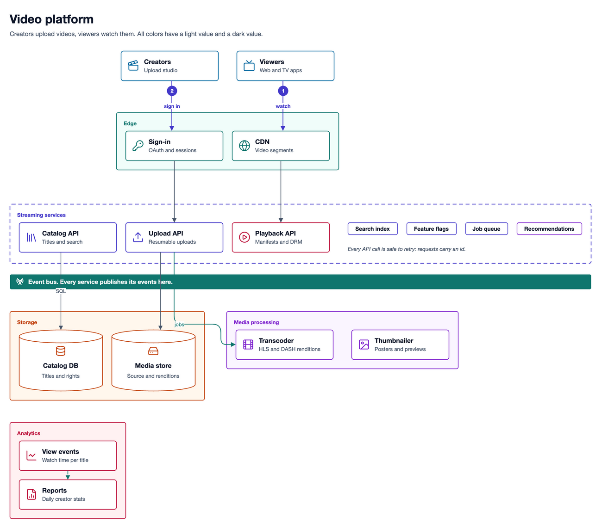
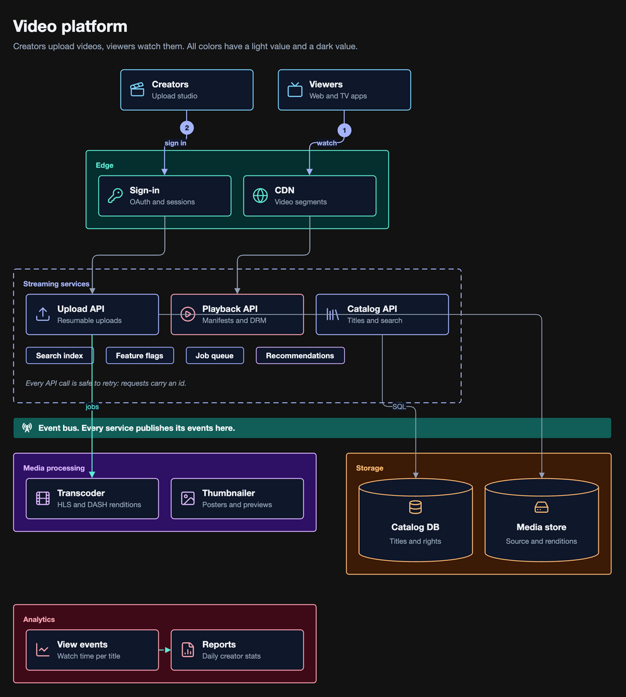

# collaborative-drawio

A command line tool, `dgm`, that lets you and an AI coding agent work on the same [draw.io](https://www.drawio.com) diagram.

The agent writes short YAML. `dgm` writes the draw.io XML, applies a professional theme that reads well in light and dark mode, keeps a history for each agent turn, and tells the agent what you changed in the draw.io app.

| Light | Dark |
|---|---|
|  |  |

These pictures come from [`examples/platform-overview.yaml`](examples/platform-overview.yaml): 2.4 KB of YAML for 38 KB of draw.io XML.

## Why

When an AI agent edits draw.io files directly, these problems occur:

- The agent writes long XML. The examples in this repository are about 16 times larger as XML than as YAML.
- For each update, the agent rewrites the whole page.
- The agent does not see the changes that you make in the draw.io app.
- The diagram looks correct in a browser, but text becomes unreadable in the draw.io desktop app in dark mode.
- The agent cannot reproduce a style that you describe in words.

`dgm` does the exact work, so the agent does not have to:

| The agent does | `dgm` does |
|---|---|
| Writes short YAML: nodes, zones, edges, a kind, a tone, an icon | Writes the draw.io XML and places the nodes |
| Sends only the changes | Applies the changes and keeps the positions that you gave |
| Reads a short list of your edits | Compares the file with the last snapshot |
| Names a kind and a tone, for example `kind: card, tone: indigo` | Writes every color as `light-dark(light, dark)` |

## How it works

```
 You (draw.io app)                 AI agent (for example Claude Code)
       |  edit + save                     |  new prompt
       v                                  v
  diagram.drawio  <---- write -----   dgm CLI  <---- skill + prompt hook
       |                                  |
       +-------- read + compare ----------+---> .dgm/   one snapshot for each agent turn
                                          +---> theme   tones, kinds, icons (light and dark)
                                          +---> draw.io CLI (PNG and SVG export)
```

1. The `.drawio` file is the only source of truth. You can open it in any draw.io app. Each cell keeps its meaning (kind, tone, icon) as cell data, which you can see in draw.io with Edit Data.
2. After `dgm` writes the file, the draw.io desktop app shows "The file has been modified. Click here to synchronize." Click it to load the change.
3. A prompt hook runs before each agent turn. When you changed a diagram, the agent gets a short list of the changes, one time. When you did not, the hook adds nothing.

## Install

You need Node.js 22 or later. For `dgm open`, `dgm export` and `dgm render`, you also need the [draw.io desktop app](https://github.com/jgraph/drawio-desktop/releases).

Install the npm package [`collaborative-drawio`](https://www.npmjs.com/package/collaborative-drawio). It gives the `dgm` command:

```sh
npm install -g collaborative-drawio
```

Each [GitHub release](https://github.com/sondt2709/collaborative-drawio/releases) also has the same package as a `.tgz` file.

Or build from the source:

```sh
git clone https://github.com/sondt2709/collaborative-drawio.git
cd collaborative-drawio
npm ci && npm run build && npm link
```

Then, in each project where an agent edits diagrams:

```sh
dgm setup        # installs .claude/skills/dgm/SKILL.md and the UserPromptSubmit hook
```

After you update dgm (`npm install -g collaborative-drawio`), run `dgm setup` again in each project. It prints `(updated)` when the skill changed. Until then, the hook tells the agent that the project skill is old.

To remove it, delete `.claude/skills/dgm/` and the `dgm hook run` entry in `.claude/settings.json`.

## Quick start

```sh
dgm create docs/arch.drawio --from examples/order-system.yaml   # also opens it in draw.io
dgm show docs/arch.drawio            # the diagram as YAML, without colors or positions
dgm apply docs/arch.drawio <<'EOF'
add:
  redis: {title: Redis, sub: Session store, icon: database, in: core}
connect:
  - "svc -> redis": reads
EOF
# Now edit the diagram in draw.io and save it.
dgm status docs/arch.drawio          # your changes since the last snapshot
dgm export docs/arch.drawio          # a light PNG in ~/Downloads, to share
```

## Commands

| Command | What it does |
|---|---|
| `dgm create <file> [--from <yaml>] [--force] [--no-open]` | Write a new diagram from YAML (standard input or `--from`), then open it in draw.io desktop |
| `dgm apply <file> [--from <yaml>]` | Change a diagram: `add`, `set`, `connect`, `move`, `remove` |
| `dgm show <file> [--geometry]` | Print the diagram as YAML in the create format |
| `dgm status <file> [--ack]` | Print the changes since the last snapshot; `--ack` records them as one human entry |
| `dgm log <file>` | List the history, newest first |
| `dgm layout <file> [--keep-moved]` | Place all nodes again; `--keep-moved` keeps nodes that you moved |
| `dgm check <file>` | Report raw colors and text with low contrast, in light and dark mode |
| `dgm open <file>` | Open a diagram in draw.io desktop |
| `dgm export <file> [--theme light\|dark] [--format png\|svg] [--scale <n>] [--out <path>]` | Export to share: light PNG, 20 px border, scale 2, to `~/Downloads/<repo>.<diagram>.<yyyyMMdd-HHmm>.png` (`-1`, `-2` when the name exists) |
| `dgm render <file> [--theme light\|dark] [--format png\|svg] [--scale <n>] [--out <path>]` | Export next to the file (`<file>.<theme>.<format>`), for the agent to look at |
| `dgm help [yaml\|edges\|apply]` | Print the commands, or the reference of a topic |
| `dgm setup [<dir>]` | Install the Claude Code skill and hook in a project |
| `dgm hook run` | The hook entry point |

Exit codes: 0 success, 1 check problems, 2 invalid input (no file is changed), 3 draw.io not found or export failed.

`dgm` finds draw.io in this order: the `DGM_DRAWIO` environment variable, `drawio` on the `PATH`, then `/Applications/draw.io.app` on macOS.

| Environment variable | Effect |
|---|---|
| `DGM_NO_OPEN=1` | `dgm create` does not open draw.io |
| `DGM_EXPORT_DIR` | The folder for `dgm export` (default `~/Downloads`) |
| `DGM_DRAWIO` | The draw.io binary |

## YAML format

```yaml
title: Order system            # optional
subtitle: One line of context  # optional
direction: down                # down (default) or right
nodes:
  api: API gateway             # a string is a card with that title
  web: {title: Web shop, sub: Storefront, icon: monitor, tone: sky}
  core:
    kind: zone
    title: Order services
    tone: violet               # cards inside use the zone tone
    nodes:
      svc: {title: Order service, sub: Creates orders, icon: server}
      queue: {kind: chip, title: Order queue}
  db: {kind: cylinder, title: Postgres, icon: database}
edges:
  - api -> svc
  - "web -> api": HTTPS
  - {from: svc, to: db, label: SQL, kind: existing, badge: 1}
```

| Key | Values |
|---|---|
| `kind` | `card` (default), `zone`, `chip`, `band`, `note`, `cylinder`, `text` |
| `tone` | `slate`, `sky`, `indigo`, `violet`, `teal`, `orange`, `rose`, `red` |
| `variant` | `dashed`, `muted`, `emphasis` |
| `icon` | a [Lucide](https://lucide.dev/icons) icon name in kebab-case, drawn as a draw.io stencil |
| edge `kind` | `default`, `new`, `existing`, `dns`, `network` |
| `style` | `stroke`, `fill`, `text` (a tone name or `accent`, `tint`, `surface`, `ink`, `muted`), `dashed`, `bold`, `width`, `height` |
| `at` | `[x, y]`, a fixed position relative to the parent |

Edges are straight lines by default. A line is exactly horizontal or vertical when the boxes overlap, and it takes a detour when the straight line would cross a box. To steer a line:

| Edge key | Values |
|---|---|
| ports | `api:r -> svc:l`: a side `t`, `r`, `b` or `l`, with an optional position on the side (`r@0.3`). Lines on one side of a box are spread out. |
| `via` | `elbow`, `above <id>`, `below <id>`, `left <id>`, `right <id>`, `x=N`, `y=N`, `[x, y]`, or a list. In the short form: `"svc:b -> db:t via below core": reads` |
| `route` | `straight` (default), `orthogonal`, `curved` |
| `layout` | `false`: the edge does not affect where boxes go (it is still drawn and routed) |

`dgm` stores this intent in the edge and computes the points again when a box moves. When you drag the points of a line in draw.io, `dgm` keeps them.

Edge labels: `dgm` puts each label on a free part of its line, or beside the line, so that it does not cover a box. `dgm create` and `dgm layout` make the gap between two boxes wide enough for the label of the line between them. `dgm check` reports a label that still covers a box. When you drag a label in draw.io, `dgm` keeps its position.

To compose a large diagram, give rows of ids, for the page or for a zone. A list inside a row is a column. Zones in one row get the same height:

```yaml
width: 2400                      # page width (optional)
rows:
  - [users, partners]
  - [onprem, cloud, [office, api]]   # office above api
nodes:
  cloud:
    kind: zone
    rows: [[gateway, lb], [app], [vpc], [gpu, data]]
    nodes: {...}
```

A band inside a zone divides the zone. `dgm show --geometry` prints the position and size of each node, for exact lanes (`via: x=N`). Change the composition later with `set: {page: {rows: [...]}}` or `set: {zone: {rows: [...]}}`, then run `dgm layout`.

Apply operations:

```yaml
add:     {cache: {title: Redis, icon: database, in: core}}   # in: a zone; near: a node id
set:     {svc: {title: Order API, sub: null}, "api -> svc": {label: gRPC}}
connect: ["svc:b -> cache:t via elbow"]
move:    {cache: {in: page}}
remove:  [queue, "web -> api"]
```

The skill in [`skill/SKILL.md`](skill/SKILL.md) gives agents the rules and a short reference. `dgm help yaml`, `dgm help edges` and `dgm help apply` print the full reference.

## Themes

The package includes the theme `pro` ([`themes/pro.yaml`](themes/pro.yaml)). Each color is a pair: a light value and a dark value. `dgm` looks for a theme in this order:

1. `.dgm/themes/<name>.yaml` next to the diagram
2. `~/.config/dgm/themes/<name>.yaml` (or `$XDG_CONFIG_HOME/dgm/themes/`)
3. the themes in the package

A theme file can start with `extends: pro` and change only some values.

Style rules in the theme (`rules`):
- A zone whose fill looks like the page background in a mode is transparent in that mode.
- Lines have rounded corners (`edgeArcSize`).
- Text and notes that sit on a zone become part of the zone, so they move with it.

## History

`dgm` keeps the history of `docs/arch.drawio` in `docs/.dgm/arch.drawio/`: a log and one small JSON snapshot for each entry (no XML). You decide whether to commit the `.dgm/` folder.

## Limits

- `dgm` changes the first page only. It keeps all other pages unchanged.
- `dgm check` gives hints (a line through a box, an almost straight line, line crossings, a label that covers a box, text that floats over a zone). The agent fixes them with another order, ports or `via`. Hints do not change the exit code.
- After you move a box in draw.io, its lines keep their old points until the next `dgm apply` or `dgm layout`.
- `dgm` cannot see edits that you did not save. Save in draw.io before you ask the agent for a change.
- When the agent changes the style of a node, your own style edits on that node are replaced by the theme style.

## Contributing

This project uses [OpenSpec](https://github.com/Fission-AI/OpenSpec) for changes and Conventional Commits for PR titles. Read `CLAUDE.md` before you open a PR.

```sh
npm ci
npm run build
npm test
git config core.hooksPath .githooks   # the sensitive-data check before each push
```

## License

MIT. See `LICENSE`. Icons: [Lucide](https://lucide.dev) (ISC). Layout: [elkjs](https://github.com/kieler/elkjs) (EPL-2.0).
